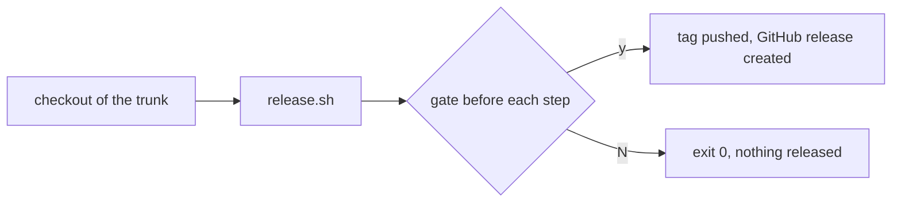
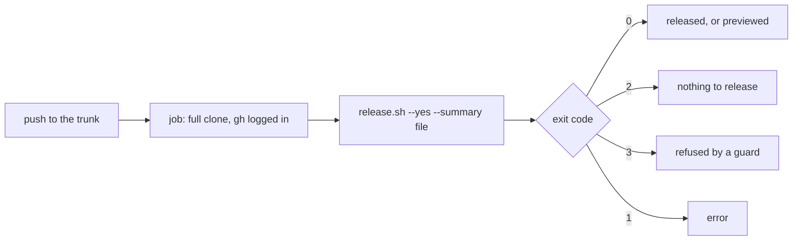
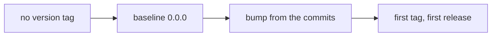
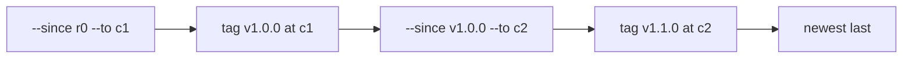
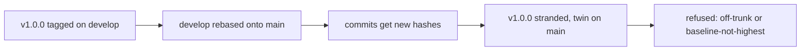
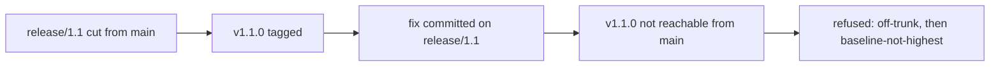
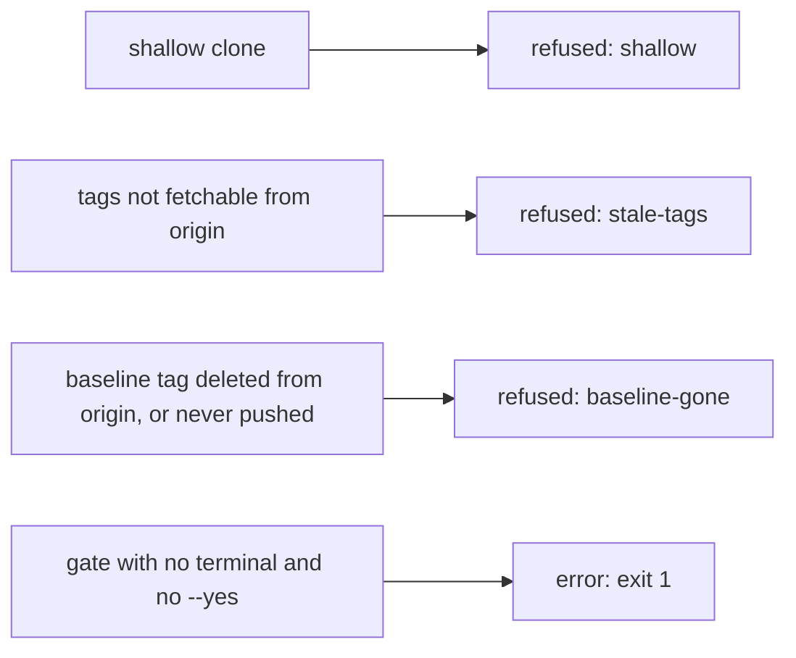

# Supported setups

Which repository setups `release.sh` releases from, and which it refuses. The rule behind every one of them: a repository has **one trunk**, every version tag sits on a commit the trunk carries, and the baseline is the highest version tag. A setup that keeps that holds; one that breaks it is refused by a guard, exit `3`, having written nothing.

`./scripts/release/release.sh --check` prints the setup report: every check below against the target a release would use, and every result at once. The terms are defined in [CONTEXT.md](../CONTEXT.md).

## Supported

### S1 - Local run on the trunk

You run the script from a checkout of the trunk (or a `release/*` branch cut from it), with a terminal to answer the gates on.



### S2 - Single-trunk CI

A job on the trunk runs `release.sh --yes`, with the full history fetched (`fetch-depth: 0`) and `gh` logged in. `--dry-run` alone previews a release on a runner: it reaches no remote, so it asks nothing.



### S3 - First release

No version tag exists yet. The baseline is `0.0.0`, so the first release lands on `0.0.1`, `0.1.0` or `1.0.0` depending on the commits, or wherever `--level` forces it. The baseline guards have no tag to weigh.



### S4 - Replay

Cutting past releases that were never tagged, with `--since <ref>` and `--to <ref>`. Oldest first: `--since` older than the latest release is refused, because the baseline would not be the highest version tag.



## Unsupported

### U1 - The develop/main rebase dance

Releasing from a branch that is later rebased onto another, so the tag written there ends up on a commit the trunk does not carry: the tag is **stranded**, and its **twin** on the trunk has a different hash. The next baseline resolved from the trunk cannot see the tag, and a release would compute a version at or below one already cut.



Refused by `off-trunk` when the target is not on the trunk, and by `baseline-not-highest` when a stranded tag sits above the baseline. Fix: find the twin (same tree) and re-point the tag at it.

### U2 - Maintenance lines

A second long-lived branch releasing an older major, such as `v1.2.1` on `1.x` while the trunk is at `v2.0.0`. Unsupported by decision (#13): no project releases an older major, and nothing in the refusal makes supporting one harder later. There is no detection of a line by name; the guards below refuse a release run from one as a side effect.

```mermaid
flowchart LR
  A[trunk at v2.0.0] --- B[1.x line at v1.2.0]
  B --> C[release v1.2.1 from 1.x]
  C --> D{trunk carries the target?}
  D -- no --> E[refused: off-trunk]
  D -- yes, --trunk 1.x --> F{baseline highest?}
  F -- v2.0.0 above v1.2.0 --> G[refused: baseline-not-highest]
```

### U3 - A release ref with extra commits

A `release/*` branch that grew a commit after the tag was cut, or a tag written on a trunk commit nobody pushed. The tag sits on a commit the trunk cannot reach.



Fix: push the extra commits to the trunk or rebase them onto it, so the tag is reachable.

### U4 - Environment traps

Setups where the script cannot see the repository whole, so a version computed from what it sees could be wrong. Each is refused rather than guessed at.



## The decision flow

The order the setup report weighs the checks in, top to bottom. The first "no" is where a release stops; the report carries on and lists every result, withholding (`skip`) only the checks that depend on a failed one.

| # | Question | If not | Exit | Fix |
| --- | --- | --- | --- | --- |
| 1 | Are `git`, `gh` and bash 4 present? | error: the tool is missing | `1` | install it |
| 2 | Inside a git repository? | error | `1` | run it from the checkout |
| 3 | Is `gh` logged in? | error | `1` | `gh auth login` |
| 4 | Does the GitHub repository resolve, and is the trunk known? | error | `1` | check the remote, or pass `--trunk` |
| 5 | Is it a full clone? | refused: `shallow` | `3` | `git fetch --unshallow`, or `fetch-depth: 0` |
| 6 | Can the version tags be fetched from `origin`? | refused: `stale-tags` | `3` | make `origin` reachable, or `git fetch --tags --force origin` |
| 7 | Is the trunk reachable on `origin`? | error | `1` | name the branch with `--trunk` |
| 8 | Does the trunk carry the target? | refused: `off-trunk` (a warning under `--dry-run`) | `3` | push the commits to the trunk, or rebase them onto it |
| 9 | Is there a half-published release on the target? | not a failure: resume at step 4, and checks 11 to 13 are not weighed | | |
| 10 | Is there a commit in the range? | nothing to release | `2` | none: the trunk is between releases |
| 11 | Is the next tag free? | refused: `tag-taken` | `3` | name a later `--to` or an earlier `--since`, or delete a stale tag |
| 12 | Is the baseline still on `origin`? | refused: `baseline-gone` | `3` | `git push origin <tag>`, or delete the local tag |
| 13 | Is the baseline the highest version tag? | refused: `baseline-not-highest` | `3` | find the stranded tag's twin, or use a `--since` no older than the latest release |
| | All yes | a release goes ahead | `0` | |

Checks 5 to 8 do not need the version, so a release runs them before computing it. Checks 11 to 13 are weighed on the version it would compute.
